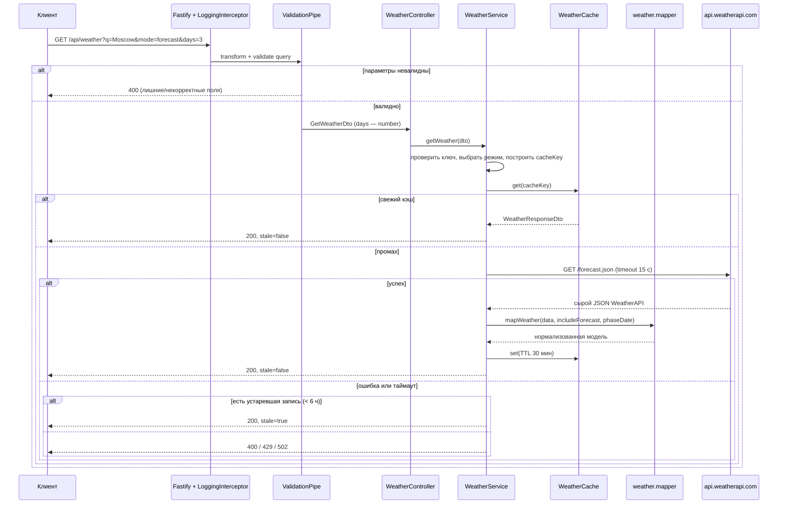

# 02. Архитектура (текущее состояние, as-is)

> Документ описывает то, что реально есть в репозитории на 22.10.2026.
> Проверено: `npm ci`, `npm run build`, `node dist/main.js`, `npm test` (27 тестов),
> `npm run test:e2e` (18 тестов) и HTTP-запросы к локальному серверу.
>
> **ИИ-слоя в коде пока нет.** Целевое место ИИ в системе — §9.1; полная модель
> «факты → промпт → гайд» — в [06](06-recommendations.md), инфраструктура — в [07](07-target-architecture.md).

## 1. Стек

| Слой | Технология | Версия | Комментарий |
|---|---|---|---|
| Runtime | Node.js | 20+ (проверено на 22) | TypeScript → CommonJS |
| Фреймворк | NestJS | 11 | `@nestjs/common`, `@nestjs/core` |
| HTTP-адаптер | Fastify | `@nestjs/platform-fastify` 11 | Не Express |
| HTTP-клиент | `@nestjs/axios` + `axios` | 12 / 1.20 | ESM-пакет, обёртка RxJS |
| Конфигурация | `@nestjs/config` | 12 | Глобальный модуль, `.env.local` → `.env` |
| Валидация | `class-validator` + `class-transformer` | 0.15 / 0.5 | Глобальный `ValidationPipe` |
| Документация API | `@nestjs/swagger` | 11 | Swagger UI `/docs`, схема `/docs-json` |
| Астрономия | `lunarphase-js` | 2.0 | Фаза и возраст Луны |
| Тесты | Jest 30 + ts-jest + supertest | — | 27 unit + 18 e2e, зелёные |
| Линт/формат | ESLint 9 (flat config), Prettier 3 | — | Плагин prettier в конфиге закомментирован, `npm run lint` падает |

Особенность ESM: `@nestjs/axios`, `@nestjs/config` и `axios` поставляются как ES-модули.
Node 22 подхватывает их при `require`, но Jest этого не умеет, поэтому тесты используют
отдельный `tsconfig.test.json` (`module: commonjs`, `allowJs`) и
`transformIgnorePatterns`, чтобы ts-jest транспилировал эти пакеты.

Имя пакета — `fishing-calendar`. Неиспользуемые зависимости (`nestjs-zod`,
`@nestjs/mapped-types`, `@fastify/static`, `update`) и константы `ONE_DAY`/`TWO_WEEKS`
удалены.

## 2. Структура репозитория

```
.
├── src
│   ├── main.ts                       # bootstrap: Fastify, configureApp, порт, обработка падения
│   ├── app.setup.ts                  # общая настройка: Swagger, CORS, /api, ValidationPipe, интерсептор
│   ├── app.module.ts                 # корневой модуль: ConfigModule + WeatherModule + HealthController
│   ├── common
│   │   └── interceptors
│   │       └── logging.interceptor.ts # request-id, лог запроса, x-request-id в ответ
│   ├── health
│   │   └── health.controller.ts      # GET /api/health
│   └── weather
│       ├── weather.module.ts         # HttpModule.register(baseURL, timeout) + WeatherCache
│       ├── weather.controller.ts     # GET /api/weather, Swagger-описание ответа и ошибок
│       ├── weather.service.ts        # режим, кэш, вызов провайдера, маппинг ошибок
│       ├── weather.cache.ts          # in-memory TTL-кэш со stale-окном
│       ├── weather.constants.ts      # TTL и лимит записей
│       ├── weather.mapper.ts         # WeatherAPI → нормализованная модель (чистые функции)
│       ├── *.spec.ts                 # unit-тесты маппера, кэша и сервиса
│       ├── providers
│       │   └── weatherapi.types.ts   # сырые типы ответа WeatherAPI (внутренние)
│       └── dto
│           ├── index.ts
│           ├── get-weather.dto.ts    # q, mode, days, date + валидация
│           └── weather-response.dto.ts # модель ответа с @ApiProperty
├── test
│   ├── app.e2e-spec.ts               # e2e: маршруты, валидация, кэш, мок HttpService
│   └── jest-e2e.json
├── docs/                             # эта документация
├── package.json / package-lock.json
├── tsconfig.json / tsconfig.build.json / tsconfig.test.json
├── nest-cli.json
├── eslint.config.mjs / .prettierrc
└── README.md / .env.example / .gitignore
```

Слоёв `domain/`/`infrastructure/` нет: структура фича-модульная. Внутри погодного модуля
уже выделены границы — сырые типы провайдера (`providers/`), чистый маппер
(`weather.mapper.ts`), адаптер кэша (`weather.cache.ts`) и публичная модель
(`dto/weather-response.dto.ts`).

## 3. Поток запроса



Ключевые отличия от прежней версии:

- **Публичный контракт — нормализованная модель**, а не сырой JSON провайдера.
  Маппер переименовывает поля (`temp_c` → `temperatureC`, `wind_kph` → `windKph`),
  приводит `is_day` к boolean, собирает `condition { text, code }`, отбрасывает
  неиспользуемые поля провайдера (`hour[]`, иконки, `moon_*`).
- **Фаза Луны считается на каждый день прогноза** (`forecast[].lunarPhase`, полдень UTC).
  Верхнеуровневый `lunarPhase` — на сегодня или на переданный `date`.
- **Параметры разделены**: `mode` выбирает эндпоинт провайдера, `days` — горизонт прогноза,
  `date` — дату фазы Луны. `days` без `mode` по-прежнему означает прогноз (совместимость).
- **Провайдер вызывается только на промахе кэша**; ошибки не кэшируются.

## 4. Конфигурация

`ConfigModule.forRoot({ envFilePath: ['.env.local', '.env'], isGlobal: true })`.
Приоритет: переменные процесса → `.env.local` → `.env`; первый существующий файл в массиве
перекрывает последующий.

| Переменная | Обязательна | Назначение | Значение по умолчанию |
|---|---|---|---|
| `PORT` | нет | Порт HTTP-сервера | `4200` |
| `WEATHER_API_KEY` | да | Ключ WeatherAPI.com | — |

- `.env.example` содержит обе переменные и коммитится; `.env` и `.env.local` — в `.gitignore`.
- `PORT` приводится к числу (`Number(process.env.PORT) || 4200`): строковое значение из env
  иначе трактуется Fastify как некорректный порт и сервер слушает случайный.
- Без `WEATHER_API_KEY` приложение стартует, но `GET /api/weather` отвечает `503`
  с явным сообщением — осознанный выбор вместо падения на старте.

## 5. Точка входа и middleware

`src/main.ts` создаёт приложение на Fastify и вызывает `configureApp(app)` из
`src/app.setup.ts` — та же настройка используется в e2e-тестах, поэтому тесты проверяют
реальную конфигурацию, а не упрощённую.

```ts
export function configureApp<T extends INestApplication>(app: T): T {
  SwaggerModule.setup('docs', app, () => SwaggerModule.createDocument(app, config));
  app.enableCors();                 // по-прежнему все origin
  app.setGlobalPrefix('api');       // все контроллеры под /api
  app.useGlobalPipes(new ValidationPipe({
    transform: true,
    whitelist: true,
    forbidNonWhitelisted: true,
  }));
  app.useGlobalInterceptors(new LoggingInterceptor());
  return app;
}
```

- Swagger: UI на `/docs`, JSON-схема на `/docs-json`, глобальный префикс на них не действует.
- `ValidationPipe` трансформирует query в типы DTO (`days` → number) и отклоняет
  неизвестные параметры.
- `LoggingInterceptor` генерирует `x-request-id` (или использует присланный), возвращает
  его в ответе, логирует метод, путь, код и длительность; 4xx — `warn`, 5xx — `error`.
- Порт: `Number(process.env.PORT) || 4200`. Ошибка старта логируется, процесс завершается
  с кодом 1.
- **Не подключены**: глобальные фильтры исключений, `helmet`, rate limiting,
  версионирование API.

## 6. Модули

### `AppModule`

`ConfigModule` (глобально), `WeatherModule`, `HealthController`. Пустые
`AppController`/`AppService` удалены — `GET /api` отвечает `404`, `GET /api/health` — `200`.

### `HealthController`

`GET /api/health` → `{ status: 'ok', uptime, timestamp }`. Внешние зависимости не опрашивает,
поэтому подходит для liveness, но не для readiness.

### `WeatherModule`

```ts
HttpModule.register({
  timeout: 15000,
  maxRedirects: 3,
  baseURL: 'https://api.weatherapi.com/v1',
})
```

Провайдеры: `WeatherService`, `WeatherCache`. Конфигурация HTTP-клиента локальна для модуля;
при появлении других интеграций её стоит вынести в общий клиент WeatherAPI за интерфейсом
`WeatherProvider` (см. [07](07-target-architecture.md), ADR A8).

### `WeatherService`

- Проверяет `WEATHER_API_KEY` через `ConfigService` → `503` при отсутствии.
- `resolveRequest` выбирает режим (`mode` или наличие `days`), отклоняет `days` при
  `mode=current` и `date` при `mode=forecast`, тримит `q` (пустой → 400), строит ключ кэша
  `wx:{mode}:{q}:{days|-}:{date|-}` и TTL.
- Кэш-хит → ответ без провайдера. Промах → `HttpService.get` через `firstValueFrom`,
  маппинг, запись в кэш.
- Сбой → лог причины (статус, код и сообщение WeatherAPI), затем устаревший кэш с
  `stale: true` либо ошибка: 400 (некорректный запрос/место), 429 (квота),
  502 (401/403, 5xx, сеть, таймаут).
- Ключ передаётся в query провайдера: HTTPS обязателен, исходящие URL целиком не логируются.

### `WeatherCache`

In-memory `Map` с TTL: 10 минут для текущей погоды, 30 минут для прогноза, stale-окно 6 часов,
лимит 500 записей с вытеснением самой старой. Методы `get`, `getStale`, `set`, `clear`.
Кэш не разделяется между инстансами и не переживает рестарт; фонового обновления
(stale-while-revalidate) нет.

### `weather.mapper.ts`

Чистые функции `mapWeather`, `mapLocation`, `mapCurrent`, `mapForecastDay`, `lunarPhaseFor`.
Не зависят от Nest и HTTP — тестируются на фикстурах реального формата WeatherAPI.

## 7. Сборка и запуск

```bash
npm ci                 # установка по lockfile
npm run build          # nest build → dist/ (tsc, CommonJS)
node dist/main.js      # прод-запуск, порт из PORT или 4200
npm run start:dev      # watch-режим
npm test               # unit: mapper, cache, service
npm run test:e2e       # e2e: маршруты, валидация, кэш
```

Проверка работоспособности:

```bash
curl "http://127.0.0.1:4200/api/health"
curl "http://127.0.0.1:4200/api/weather?q=Moscow"
curl "http://127.0.0.1:4200/api/weather?q=Moscow&mode=forecast&days=3"
```

`tsconfig.json`: `module`/`moduleResolution` = `nodenext`, `target` ES2023,
`strictNullChecks: true`, но `noImplicitAny: false` и `strictBindCallApply: false` —
строгость ниже, чем у нового Nest-проекта (остаётся в техдолге).
`tsconfig.test.json` переопределяет модуль на CommonJS и включает `allowJs` только для
Jest, прод-сборка его не использует.

## 8. Тесты

| Команда | Результат |
|---|---|
| `npm test` | 3 suites, 27 тестов — маппер, TTL-кэш, сервис (кэш-хиты, stale, `mode`/`days`/`date`, 400/429/502/503) |
| `npm run test:e2e` | 1 suite, 18 тестов — `/api/health`, валидация всех сочетаний параметров, нормализованный ответ, Луна по дням, обратная совместимость `days`, повторный запрос из кэша |

E2E поднимает приложение через `configureApp` с `FastifyAdapter` и подменяет `HttpService`
моком, поэтому не ходит в сеть и не расходует квоту провайдера.

Что не покрыто: реальный провайдер (контрактные тесты), конкурентные запросы и дедупликация,
поведение кэша при нескольких инстансах.

## 9. Что архитектурно отсутствует

- Слой хранения: БД, миграции, репозитории.
- Доменные модули: `fish`, `water-bodies`, `reports`, `recommendations`, `rules`.
- Провайдер-интерфейс и второй источник погоды (Open-Meteo) с фолбэком.
- Фоновое обновление кэша (stale-while-revalidate), дедупликация одновременных запросов.
- Планировщик (`@nestjs/schedule`) для предрасчёта календаря и обновления прогнозов.
- Аутентификация/авторизация, пользователи, роли, модерация.
- Наблюдаемость: метрики, трассировка, readiness-проверка зависимостей (health есть).
- Rate limit, ретраи с backoff, версионирование API (`/api/v1`).
- **ИИ-слой**: LLM-клиент, сборка промпта, схема гайда, guardrails, кэш ИИ-ответов,
  аудит вызовов, бюджет и фолбэк (§9.1).
- Почасовой прогноз в модели ответа: сейчас маппер отбрасывает `hour[]`, без него нельзя
  считать окна активности и передавать ИИ почасовые факторы.
- Контейнеризация, CI, конфигурация окружений (dev/stage/prod).

### 9.1. Куда встроится ИИ-слой

ИИ — не замена погодному модулю, а следующий слой над ним. Целевой поток:

```
weather + water-body + species + reports + rules
        ↓  (facts.builder)
детерминированные факты: score, breakdown, warnings, confidence
        ↓  (prompt.builder + guide.schema)
LLM API (OpenAI-совместимый, провайдер из конфига)
        ↓  (guide.guardrails)
гайд → recommendation.guide + ai_run (модель, токены, стоимость, статус)
        ↓
GET /api/v1/recommendations
```

Место в коде — `src/recommendations/ai/` (промпт, LLM-клиент, схема, проверки, фолбэк,
кэш по `inputsHash`). Погодный модуль остаётся источником фактов; его контракт
(нормализованная модель) уже готов к этому. Ключи LLM — только в env (`LLM_API_KEY`,
`LLM_BASE_URL`, `LLM_MODEL`), не в клиенте.

Ограничение текущего состояния: `weather` отдаёт только суточную сводку, а для окон
активности и честного промпта нужны почасовые ряды — это первый шаг этапа 1
(см. [08](08-roadmap.md)).

Целевая архитектура и порядок её внедрения — в [07-target-architecture.md](07-target-architecture.md)
и [08-roadmap.md](08-roadmap.md). Детали контракта — в [03-api-reference.md](03-api-reference.md),
статус и техдолг — в [04-implementation-status.md](04-implementation-status.md).
