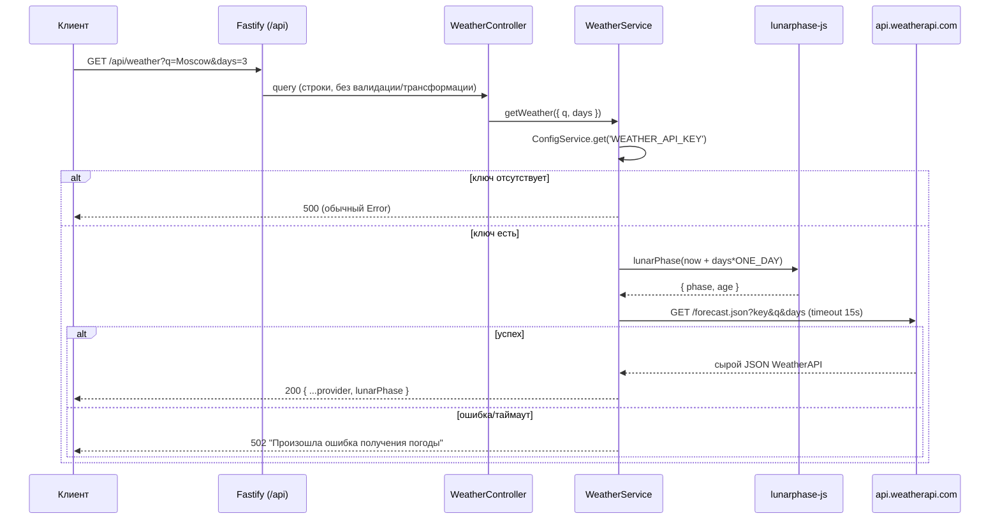

# 02. Архитектура (текущее состояние, as-is)

> Документ описывает то, что реально есть в репозитории. Всё, что ниже, проверено
> запуском: `npm ci && npm run build && node dist/main.js` — приложение поднимается,
> маршрут `GET /api/weather` отвечает. Тесты при этом падают (см. раздел 8).

## 1. Стек

| Слой | Технология | Версия | Комментарий |
|---|---|---|---|
| Runtime | Node.js | 18+ (по факту 22) | TypeScript-сборка в CommonJS |
| Фреймворк | NestJS | 11 | `@nestjs/common`, `@nestjs/core` |
| HTTP-адаптер | Fastify | `@nestjs/platform-fastify` 11 | Не Express |
| HTTP-клиент | `@nestjs/axios` + `axios` | 12 / 1.20 | Обёртка RxJS |
| Конфигурация | `@nestjs/config` | 12 | Глобальный модуль, ждёт `.env` |
| Валидация | `class-validator` + `class-transformer` (через Nest) | 0.15 | **Не подключена глобально** |
| Документация API | `@nestjs/swagger` | 11 | Swagger UI на `/docs` |
| Астрономия | `lunarphase-js` | 2.0 | Фаза и возраст Луны |
| Тесты | Jest 30 + ts-jest, supertest | — | Конфигурация устарела/сломана |
| Линт/формат | ESLint 9 (flat config), Prettier 3 | — | Prettier-плагин в ESLint закомментирован |

Зависимости, объявленные, но не используемые в коде: `nestjs-zod`, `@nestjs/mapped-types`,
`@fastify/static`, `update`, `class-transformer` (транзитивно через Nest). Это наследие
других заготовок и кандидаты на удаление.

В `package.json` осталось имя `english-tutor` — проект переименован не был.

## 2. Структура репозитория

```
.
├── src
│   ├── main.ts                     # bootstrap: Fastify, Swagger, CORS, prefix /api, порт
│   ├── app.module.ts               # корневой модуль: WeatherModule + ConfigModule
│   ├── app.controller.ts           # пустой контроллер без маршрутов
│   ├── app.service.ts              # пустой сервис
│   ├── common
│   │   ├── index.ts                # реэкспорт
│   │   └── constants/index.ts      # ONE_DAY, TWO_WEEKS (TWO_WEEKS не используется)
│   └── weather
│       ├── weather.module.ts       # HttpModule.register(baseURL, timeout)
│       ├── weather.controller.ts   # GET /api/weather
│       ├── weather.service.ts      # вызов WeatherAPI + фаза Луны
│       └── dto
│           ├── index.ts
│           └── get-weather.dto.ts  # GetWeatherDto + интерфейсы ответа WeatherAPI
├── test
│   ├── app.e2e-spec.ts             # устаревший e2e (GET / → "Hello World!")
│   └── jest-e2e.json
├── docs/                           # эта документация
├── package.json / package-lock.json
├── tsconfig.json / tsconfig.build.json
├── nest-cli.json
├── eslint.config.mjs / .prettierrc
└── README.md
```

Слоёв (`domain/`, `infrastructure/`, `application/`) нет: структура — классическая
Nest-«фича-модульная», где каждый модуль содержит контроллер, сервис и DTO.

## 3. Поток запроса



Особенности, важные для интеграции:

- **Ответ — это «сырой» JSON WeatherAPI** плюс поле `lunarPhase`. Внутренней модели нет:
  интерфейсы `GetWeatherResponse`, `Current`, `Forecast`, `Forecastday`, `Day`, `Astro`,
  `Location` описаны в DTO, но нигде не используются для маппинга.
- **Фаза Луны считается на дату `now + days`**, то есть при `days=3` — на третий день
  прогноза (проверено: `lunarPhase.age` сдвигается ровно на 3 суток). Для календаря нужна
  фаза **на каждый день**, а не одна на весь ответ.
- `days` — единственный переключатель: есть значение → `/forecast.json`, нет → `/current.json`.
- Провайдер вызывается **на каждый запрос**, без кэша и дедупликации.

## 4. Конфигурация

`ConfigModule.forRoot({ envFilePath: '.env', isGlobal: true })`.

| Переменная | Обязательна | Назначение | Значение по умолчанию |
|---|---|---|---|
| `PORT` | нет | Порт HTTP-сервера | `4200` |
| `WEATHER_API_KEY` | да | Ключ WeatherAPI.com | — |

**Проблема окружения.** В рабочей копии присутствует только `.env.local` (он в
`.gitignore` и управляется Freebuff), а `ConfigModule` читает `.env`. В результате:

- при запуске через `npm run start` без предварительного `export` ключа сервис вернёт
  `500` на `/api/weather`;
- при запуске `node dist/main.js` с переменными, экспортированными в оболочку, всё
  работает — так и была проверена текущая версия.

Рекомендуемое минимальное исправление: `envFilePath: ['.env.local', '.env']` либо
перейти на `.env` и завести `.env.example` (см. [04](04-implementation-status.md)).

## 5. Точка входа и middleware

`src/main.ts`:

```ts
const app = await NestFactory.create<NestFastifyApplication>(AppModule, new FastifyAdapter());
app.enableCors();                     // разрешены все origin
app.setGlobalPrefix('api');           // все контроллеры под /api
await app.listen(process.env.PORT ?? 4200);
```

- Swagger: `SwaggerModule.setup('docs', app, ...)` → доступен на `/docs`
  (глобальный префикс на него не распространяется), title «Fishing Calendar», версия 1.0.
- **Не подключены**: `ValidationPipe`, глобальные фильтры исключений, интерсепторы
  логирования/таймингов, `helmet`, rate limiting, версионирование API.
- Ошибки bootstrap не логируются и не обрабатываются (`bootstrap()` без `catch`).

## 6. Модули

### `AppModule`
Импортирует `WeatherModule` и `ConfigModule` (глобально). `AppController`/`AppService`
пустые: маршрутов нет, `GET /api` отвечает `404` (проверено).

### `WeatherModule`
```ts
HttpModule.register({
  timeout: 15000,
  maxRedirects: 3,
  baseURL: 'https://api.weatherapi.com/v1',
})
```
Регистрация «на модуль», а не глобально: при появлении других интеграций конфигурацию
лучше вынести в общий `HttpModule` или отдельный клиент WeatherAPI.

### `WeatherService`
- `getWeather(dto)` — выбор эндпоинта, проверка ключа, вызов, добавление `lunarPhase`.
- `getLunarPhase(date?)` — `{ phase, age }` из `lunarphase-js`; `age` — возраст Луны в днях
  (`null`, если дата некорректна — например, при `days=abc`).
- Ключ передаётся в query провайдера, поэтому **обязателен HTTPS** и запрет логирования
  исходящих URL (иначе ключ попадёт в логи).

## 7. Сборка и запуск (проверено)

```bash
npm ci                 # установка по lockfile
npm run build          # nest build → dist/ (tsc, CommonJS)
node dist/main.js      # прод-запуск, порт из PORT или 4200
npm run start:dev      # watch-режим
```

Проверка работоспособности:

```bash
curl "http://127.0.0.1:4200/api/weather?q=Moscow"
curl "http://127.0.0.1:4200/api/weather?q=Moscow&days=3"
```

`tsconfig.json`: `module`/`moduleResolution` = `nodenext`, `target` ES2023,
`strictNullChecks: true`, но `noImplicitAny: false` и `strictBindCallApply: false` —
строгость ниже, чем у нового Nest-проекта. Абсолютный импорт `src/common` компилируется
корректно в относительный `../common`, так что прод-сборка рабочая.

## 8. Тесты (фактически красные)

| Команда | Результат |
|---|---|
| `npm test` | `No tests found, exiting with code 1` — unit-тестов нет |
| `npm run test:e2e` | Падение на импорте `@nestjs/axios`: `SyntaxError: Unexpected token 'export'` — ts-jest не настроен на ESM-пакеты |

Дополнительно сам e2e-тест устарел: он ждёт `GET /` → `"Hello World!"`, тогда как
маршрута нет и включён префикс `api`. То есть тестовая инфраструктура не просто не
покрывает код — она не запускается. Это блокер для CI и для регрессионной защиты при
дальнейшем развитии.

## 9. Что архитектурно отсутствует

- Слой хранения: БД, миграции, репозитории.
- Доменные модули: `fish`, `water-bodies`, `reports`, `recommendations`, `rules`.
- Кэш (погода идеально кэшируется по `q + дата`).
- Планировщик (`@nestjs/schedule`) для предрасчёта календаря и обновления прогнозов.
- Аутентификация/авторизация, пользователи, роли, модерация.
- Наблюдаемость: структурные логи, request-id, health-check (`/api/health`), метрики.
- Контейнеризация, CI, конфигурация окружений (dev/stage/prod).

Целевая архитектура и порядок её внедрения — в [07-target-architecture.md](07-target-architecture.md)
и [08-roadmap.md](08-roadmap.md).
