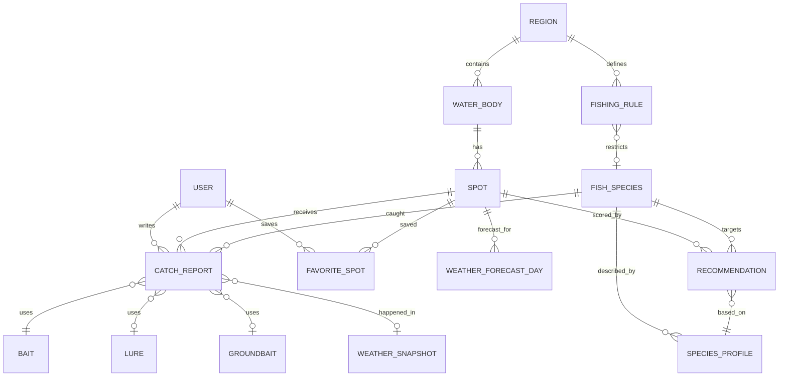

# 05. Системный анализ: предметная область и данные

Документ фиксирует, **из чего состоит продукт** и какие данные для этого нужны. Он не
описывает текущий код (там домена нет) — это основа для проектирования. Текущая реализация
покрывает только блок «погода + Луна», см. [04](04-implementation-status.md).

## 1. Стейкхолдеры и их интересы

| Стейкхолдер | Интерес | Что важно в системе |
|---|---|---|
| Рыболов-пользователь | Поймать рыбу, не потратить день зря | Точность оценки, локальность, объяснимость, скорость |
| Локальный эксперт / автор отчётов | Признание, обмен опытом | Простая фиксация улова, честная модерация, защита точек |
| Владелец водоёма/базы | Поток клиентов | Страница водоёма, прогноз, актуальные условия |
| Контент-редактор | Поддержка базы знаний о рыбах и правилах | Удобная CMS, версионирование, источники |
| Разработчик/эксплуатация | Стабильность и стоимость | Кэш, квоты провайдеров, наблюдаемость |
| Регулятор (косвенно) | Соблюдение правил рыболовства | Справочник запретов, дисклеймеры |

## 2. Доменная модель

### 2.1. Сущности и ключевые атрибуты

**Region** — регион/область: `id`, `name`, `country`, `timezone`, `fishingRulesSourceUrl`.
Нужен для правил рыболовства, часового пояса и региональных профилей видов.

**WaterBody (водоём)** — `id`, `regionId`, `name`, `type` (`river | lake | reservoir | pond |
commercial | sea`), `geometry` (полигон/линия), `areaHa`, `maxDepthM`, `avgDepthM`,
`flow` (`still | slow | medium | fast`), `clarity` (`clear | moderate | turbid`),
`bottom` (`sand | mud | stone | mixed`), `waterLevelSource`, `access` (берег/лодка/платно),
`isPaid`, `contacts`.

**Spot (точка)** — `id`, `waterBodyId`, `name`, `location` (Point, WGS84), `bankSide`,
`depthM`, `bottom`, `snags`, `walkMinutes`, `isPublic`, `createdBy`, `status`
(`active | hidden | removed`). Точка — единица расчёта рекомендаций: погода, отчёты и
оценки привязаны к ней (или к водоёму, если точки нет).

**FishSpecies (вид)** — `id`, `name`, `latin`, `family`, `isPredator`, `minSizeCm` и
`dailyNorm` (справочно, из правил), `coverImage`.

**SpeciesProfile (профиль повадок)** — версионируемая запись: `speciesId`, `version`,
`regionId?`, `waterTempOptimalC: [min, max]`, `waterTempRangeC: [min, max]`,
`spawningMonths: int[]`, `activityByMonth: {1..12: 0..1}`, `activityByHour: {0..23: 0..1}`,
`pressureSensitivity` (`low | medium | high`), `pressureTrendPreference`
(`stable | rising | falling | any`), `windPreference: {dirs: string[], maxKph}`,
`lightPreference` (`dawn | day | dusk | night | any`), `depthPreferenceM: [min, max]`,
`preferredHabitats: string[]`, `notes`, `sources: string[]`, `updatedBy`.
Профиль — это **данные, а не код**: редактируется контент-командой и не требует релиза.

**WeatherSnapshot** — фактическая погода на момент/около момента: `provider`,
`locationKey` (округлённые координаты), `observedAt`, `tempC`, `pressureMb`,
`pressureTrend6h/24h`, `windKph`, `windDir`, `cloudPct`, `precipMm`, `humidityPct`,
`waterTempEstimatedC`, `raw` (JSONB), `expiresAt`.

**WeatherForecastDay** — нормализованный прогноз на сутки для точки: `spotId`, `date`,
`tMinC`, `tMaxC`, `pressureAvgMb`, `pressureTrend`, `windAvgKph`, `windDir`,
`cloudPct`, `precipMm`, `moonPhase`, `moonIllumination`, `sunrise`, `sunset`,
`hourly` (JSONB: температура/давление/ветер/осадки по часам), `provider`, `fetchedAt`.

**CatchReport (отчёт)** — `id`, `userId`, `spotId`, `waterBodyId`, `fishedAt`,
`timeFrom`, `timeTo`, `speciesId`, `count`, `weightKg`, `lengthCm`, `released`,
`baitId?`, `lureId?`, `groundbaitId?`, `rig` (текст/структура), `notes`,
`photoKeys[]`, `weatherSnapshotId`, `result` (`caught | bites_only | skunked`),
`moderationStatus` (`pending | approved | rejected`), `trustScore`, `createdAt`.
Отчёт с `result = skunked` так же ценен, как успешный: он отрицательный сигнал.

**Bait / Lure / Groundbait** — справочники: наживки (`worm, maggot, corn, boilie, ...`),
приманки (`jig, wobbler, spinner, ...` с размером/цветом), прикормки (состав, фракция,
бренд). Нужны для агрегации «что работает» и для рекомендаций.

**Recommendation** — результат расчёта: `spotId`, `speciesId`, `date`, `score` (0–100),
`breakdown` (JSONB: вклад каждого фактора), `windows` (часы активности),
`tackle` (оснастка, поводок, крючок, груз), `baits`, `groundbait`, `tactics`,
`warnings[]`, `ruleRefs[]`, `modelVersion`, `inputsHash`, `generatedAt`.
Хранится, чтобы не пересчитывать и чтобы можно было объяснить/воспроизвести.

**FishingRule** — `regionId`, `waterBodyId?`, `speciesId?`, `type`
(`spawning_ban | gear_restriction | min_size | daily_norm | closed_area`),
`dateFrom`, `dateTo`, `text`, `sourceUrl`, `verifiedAt`.

**User** — `id`, `email`, `displayName`, `regionId`, `role` (`user | expert | moderator | admin`),
`createdAt`. Плюс `FavoriteSpot`.

### 2.2. Инварианты и правила целостности

1. Любая рекомендация **объяснима**: сумма вкладов в `breakdown` равна `score`
   (с точностью округления), у каждого вклада есть человекочитаемая причина.
2. Отчёт всегда привязан к точке (или к водоёму), виду и времени; координаты — WGS84,
   время — UTC в хранилище, локальное — на выдаче.
3. Региональные правила имеют источник и дату проверки; рекомендация не может советовать
   ловлю в запрещённый период — вместо этого выдаётся предупреждение.
4. Профили видов версионируются; рекомендация хранит `modelVersion` + `inputsHash`,
   чтобы прошлые результаты воспроизводились.
5. Единицы измерения канонические: °C, гПа, км/ч, мм, м, кг, см. Никаких °F/миль в домене.
6. Пользовательские данные (отчёты, точки) не удаляются физически без запроса владельца;
   «удаление» — статус + анонимизация авторства.
7. Точки, созданные пользователями, по умолчанию приватны; публикация — осознанное действие.

## 3. Данные и источники

| Данные | Источник | Статус | Ограничения |
|---|---|---|---|
| Текущая погода, прогноз | WeatherAPI.com (уже интегрирован) | ✅ есть | Бесплатный тариф — **3 дня** прогноза, квота ~1 млн/мес, без SLA |
| Почасовой прогноз, архив | Open-Meteo (бесплатно, без ключа) | 💡 кандидат | Нет актуального давления в некоторых моделях; отличный источник для истории и бэктестов |
| Восход/закат/Луна | WeatherAPI `astro` + `lunarphase-js` | ✅ есть | Луна должна считаться на каждый день |
| Температура **воды** | нет доступного источника | ❌ пробел | Оценивать по температуре воздуха (сглаженная модель) и/или собирать от пользователей |
| Уровень воды, расход | гидропосты (ЕСИМО/RFC) — нет открытого API | ❌ пробел | На MVP — ручные заметки и косвенные признаки (осадки за 3–7 дней) |
| Водоёмы и точки | ручной каталог + OpenStreetMap | 💡 кандидат | Требует редактуры; OSM даёт геометрию, но не глубины |
| Виды рыб и повадки | экспертная база (книги, ихтиология, практика) | 💡 нужно создать | Требует источников и ревью, 10–15 видов на MVP |
| Отчёты о рыбалке | пользователи | ❌ нет | Холодный старт, спам, смещение выборки |
| Правила рыболовства | официальные региональные документы | ❌ нет | Меняются ежегодно, нужна ручная сверка |
| Погодная история для обучения | Open-Meteo archive + архив отчётов | 💡 позже | Нужно ≥1 сезона данных |

### 3.1. Пространственное разрешение — ключевой риск

Погодные модели дают сетку 1–11 км; микроклимат водоёма (бриз, затишье в заливе, тень
леса) может отличаться заметно. Поэтому:

- рекомендации считаются **для точки**, а не «для города»;
- поле `q` в текущем API (город) годится только для черновика — нужна работа по координатам;
- в карточке рекомендации честно указывать «прогноз по сетке, локальные условия могут
  отличаться».

## 4. Пользовательские сценарии → данные

| Сценарий | Нужные данные | Нужные операции |
|---|---|---|
| Календарь на 7–14 дней | прогноз по точке, профили видов, правила | агрегация по дням, кэш, предрасчёт |
| «Что взять» | профиль вида, погода дня, отчёты локации, справочники снастей | скоринг + выбор снасти/наживки |
| Отчёт об улове | точка, вид, снасть, фото, погода момента | создание, модерация, агрегация |
| «Что ловят рядом» | отчёты в радиусе, свежесть, вид | геопоиск, взвешивание |
| Проверка запрета | регион, водоём, вид, дата | выборка правил, пересечение периодов |
| Избранное и уведомления | пользователь, точки, подписки | фоновые задачи, push/email |

## 5. Качество данных и доверие

1. **Холодный старт отчётов.** В новом регионе отчётов нет → рекомендации опираются только
   на профили видов и погоду. Это нормально, но должно быть видно пользователю
   («мало данных по этой локации»).
2. **Смещение выборки.** Пишут успешные; «пустые» выезды почти не публикуют → оценка
   завышается. Решение: явно просить и учитывать `skunked`, взвешивать по полноте.
3. **Спам и реклама точек.** Нужны: rate limit, модерация первых N отчётов, репутация,
   проверка гео (точка в пределах водоёма), фото-хеш на дубликаты.
4. **Точность координат.** Телефон в лесу даёт ±30–100 м; для реки это другой участок.
   Хранить `accuracyM` и не смешивать отчёты с низкой точностью в одну точку.
5. **Часовые пояса и переход на летнее время.** Все расчёты «окон активности» — в
   локальном времени точки, хранение — UTC.
6. **Юридическая осторожность.** Рекомендации — не гарантия улова; обязателен дисклеймер
   и приоритет официальных правил над советами сервиса.

## 6. Открытые вопросы (нужны решения владельца продукта)

1. **География MVP**: один регион или «Россия целиком»? От этого зависит объём каталога
   водоёмов и справочника правил.
2. **Источник прогноза на 7–14 дней**: платный тариф WeatherAPI, Open-Meteo или их
   комбинация с фолбэком?
3. **Температура воды**: оценивать моделью (дёшево, неточно) или собирать у пользователей
   (точно, но требует аудитории)?
4. **Приватность точек**: показывать ли точные координаты чужих уловов или округлять
   до 300–500 м?
5. **Монетизация**: подписка на расширенный прогноз, партнёрство с базами, реклама?
6. **Языки и регионы**: только RU/Russia на старте?
7. **Формат отчётов**: только текст+фото или сразу структурированные поля (вид, вес, снасть)?

Ответы на 1–3 определяют объём этапа 1 в [08-roadmap.md](08-roadmap.md). Модель
рекомендаций, которая потребляет эти данные, описана в [06-recommendations.md](06-recommendations.md).
