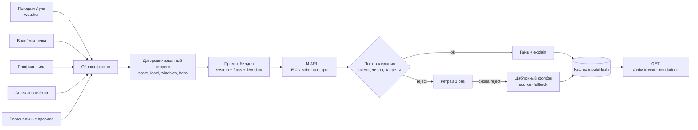

# 06. Ядро продукта: ИИ-гайд на рыбалку

Рекомендацию формирует **ИИ-модель**: ей передаются все факторы ловли, а на выходе
получается готовый гайд — окна активности, снасть, поводок, наживка, прикормка, тактика,
предупреждения и объяснение. Модель не «угадывает» условия: числа, оценку дня и
юридические ограничения считает детерминированный код, а ИИ объясняет и собирает из них
рекомендацию.

Это главный принцип документа: **факты проверяемы, текст — генеративный**. Если
рекомендация расходится с фактами или снимает запрет, она отклоняется пост-валидацией,
даже если выглядит убедительно.

## 1. Конвейер



Порядок важен: модель получает **уже посчитанные** значения (`score`, `breakdown`,
`warnings`, `confidence`), а не сырые данные провайдера, поэтому не может «пересчитать»
погоду по-своему.

## 2. Почему готовая модель, а не обучение

| Вариант | Плюсы | Минусы | Решение |
|---|---|---|---|
| Обучение с нуля | Полный контроль | Нет данных, дорого, необъяснимо | ❌ |
| Дообучение (fine-tune) на отчётах | Стиль и локальная специфика | Нужно ≥1 сезона размеченных данных и инфраструктура | ⏳ позже, этап 5 |
| Готовая LLM через API | Быстрый старт, сильный язык, объяснения | Стоимость, задержка, галлюцинации | ✅ MVP |
| Только правила без ИИ | Детерминизм, дёшево | Сухой шаблонный текст, плохо переносит новые условия | ✅ фолбэк |

На старте используется **внешний LLM-провайдер с OpenAI-совместимым API** (например, Z.ai;
конкретный провайдер и модель — конфигурация, не код: `LLM_API_KEY`, `LLM_BASE_URL`,
`LLM_MODEL`). Смена провайдера не должна требовать изменений в домене — только адаптер.

Дообучение имеет смысл позже и только на **стиле и локальных нюансах**, не на цифрах:
факты и запреты остаются за детерминированным слоем.

## 3. Что получает ИИ: контракт фактов

Факты собираются из доменных модулей и передаются модели одним JSON-объектом.

| Блок | Содержимое | Источник |
|---|---|---|
| `spot` | Водоём, тип, течение, прозрачность, глубина, точка, часовой пояс | `water_body`, `spot` |
| `date` | Дата и локальное время, сезон, восход/закат | weather + регион |
| `species` | Профиль вида: оптимальные температуры, сезонная и суточная активность, нерест, реакция на давление, предпочтения по свету/ветру/глубине | `species_profile` |
| `weather.daily` | Мин/макс температура, давление и тренд, ветер и порывы, облачность, осадки |weather (нормализованная модель) |
| `weather.hourly` | Почасовые температура, давление, ветер, облачность, осадки, вероятность дождя | weather (почасовые данные — требование этапа 1) |
| `moon` | Фаза, возраст, освещённость, лунные восход/закат | weather + `lunarphase-js` |
| `reports` | Агрегаты по точке и радиусу: число отчётов, успешность, свежесть, работающие наживки/снасти | `catch_report` (approved) |
| `rules` | Запреты, ограничения снастей, минимальный размер, нормы | `fishing_rule` |
| `score` | `value` 0–100, `label`, `breakdown[]`, `penalties[]`, `confidence` | детерминированный скоринг |
| `gear` | Набор снастей пользователя (если известен) | профиль (позже) |
| `language` | Язык гайда (`ru` на старте) | запрос |

Пример (сокращён):

```jsonc
{
  "spot": { "id": "sp_1", "waterBody": { "name": "Истринское", "type": "reservoir",
            "flow": "still", "clarity": "moderate" }, "depthM": 4.5, "timezone": "Europe/Moscow" },
  "date": "2026-10-25",
  "species": { "slug": "pike", "waterTempOptimalC": [8, 15], "spawningMonths": [],
               "pressureSensitivity": "high", "lightPreference": "dusk" },
  "weather": {
    "daily": { "tMinC": 4.2, "tMaxC": 9.1, "pressureMb": 1024, "pressureTrend": "+1 гПа/6ч",
               "windKph": 14, "windDir": "SW", "cloudPct": 60, "precipMm": 0 },
    "hourly": [ { "time": "07:00", "tempC": 5.1, "pressureMb": 1024, "windKph": 12 } ]
  },
  "moon": { "phase": "Full", "age": 14.5, "illuminationPct": 99 },
  "reports": { "total": 3, "successful": 2, "freshnessDays": 4,
               "topBaits": ["виброхвост 12 см"], "topRigs": ["джиг"] },
  "rules": [],
  "score": { "value": 88, "label": "отличный", "confidence": "high",
             "breakdown": [ { "factor": "waterTemperature", "impact": 0.95, "weight": 25 } ] }
}
```

Чего в фактах быть не должно: имён, email, точных координат чужих точек, свободного текста
отчётов без обработки (см. § 9), ключей провайдеров.

## 4. Что возвращает модель: схема гайда

Ответ — строгий JSON по схеме (`guide-v1`), без markdown и «рассуждений».

```jsonc
{
  "version": "guide-v1",
  "summary": "2–4 предложения: стоит ли ехать и почему.",
  "label": "отличный",
  "species": [
    { "slug": "pike", "name": "щука", "likelihood": 0.82, "why": "вода 9 °C в оптимуме" }
  ],
  "windows": [
    { "from": "07:00", "to": "09:00", "activity": 0.91, "note": "пик на рассвете" }
  ],
  "tackle": {
    "rig": "джиг",
    "leader": { "material": "флюорокарбон", "diameterMm": 0.4, "lengthCm": 25 },
    "hook": "офсет 3/0",
    "weight": "14 г",
    "notes": "проверять поводок после каждой щуки"
  },
  "baits": [ { "name": "виброхвост", "sizeCm": 12, "priority": 1, "note": "натуральные цвета" } ],
  "groundbait": { "applicable": false, "composition": null, "amount": null, "feeding": null },
  "tactics": [ "облавливать бровку 3–5 м", "проводка ступенчатая" ],
  "warnings": [],
  "explain": [
    { "factor": "waterTemperature", "value": "9 °C", "impact": 0.95, "text": "в оптимуме вида" }
  ],
  "confidence": "high",
  "disclaimer": "Оценка условий, а не гарантия улова. Приоритет — официальные правила региона."
}
```

| Поле | Обязательно | Правило |
|---|---|---|
| `summary`, `label`, `confidence` | да | `label` и `confidence` совпадают с фактами |
| `species[]` | да | только `slug` из каталога, `likelihood` 0–1 |
| `windows[]` | да | локальное время точки, внутри светового дня или разрешённой ночи |
| `tackle`, `baits[]`, `groundbait` | да | снасти из справочника, без выдуманных брендов |
| `warnings[]` | да | все запреты и опасности из `rules`/фактов присутствуют дословно |
| `explain[]` | да | ссылается на факторы и их значения |
| `disclaimer` | да | фиксированный текст или его эквивалент |

`score` в ответ API добавляется кодом, а не моделью.

## 5. Промпт

Собирается кодом (`prompt.builder.ts`), версионируется (`promptVersion`), хранится в
репозитории вместе со схемой ответа.

**System-промпт** (сокращённо):

> Ты — эксперт-рыболов и автор практических гайдов. Пиши по-русски, кратко и по делу.
> Возвращай **только JSON** по предоставленной схеме. Используй только виды, снасти и
> наживки из списка. Числа (температура, давление, ветер, Луна, оценка) бери из фактов,
> не пересчитывай и не придумывай. Если в `rules` есть запрет — он обязателен в `warnings`,
> и ты не советуешь ловить в запрещённый период. Не гарантируй улов, не обещай килограммы.
> Не добавляй сведения, которых нет в фактах.

**User-сообщение**: JSON фактов + инструкция «сформируй гайд по схеме, объясни вклад
факторов, укажи окна в локальном времени».

**Few-shot**: 2–3 эталонных пары «факты → гайд» из golden-набора (щука осенью, лещ на
фидере, карась летом). Они же служат регрессией при смене промпта.

Параметры вызова: `temperature 0.2`, `top_p 0.9`, лимит токенов ответа ~1500, таймаут 25 с,
один ретрай. При поддержке провайдером — structured output/JSON schema.

## 6. Пост-валидация и guardrails

Ответ модели не публикуется напрямую. Проверки идут по порядку, при провале — ретрай с
описанием ошибки, затем фолбэк.

| # | Проверка | Действие при провале |
|---|---|---|
| 1 | JSON валиден и соответствует схеме, нет лишних полей | reject → retry |
| 2 | `label`, `confidence`, `score`-контекст совпадают с фактами | заменить на значения кода, отметить `corrected` |
| 3 | Все запреты из `rules` присутствуют в `warnings` | reject (юридический риск) |
| 4 | Нет советов ловить в запрет, на тонком льду, в грозу | reject |
| 5 | `species[].slug` и снасти есть в каталоге | reject/удалить неизвестное + retry |
| 6 | Числа в `explain` не противоречат фактам (допуск на округление) | reject |
| 7 | Окна в пределах суток и локального времени точки | clamp + предупреждение |
| 8 | `disclaimer` присутствует | добавить кодом |
| 9 | Длина и язык ответа в допустимых границах | trim / reject |

Дополнительно:
- **Бюджет**: превышение дневного лимита → сразу фолбэк, без вызова модели.
- **Таймаут/5xx провайдера** → фолбэк; пользователь видит `source: "fallback"`.
- **Фолбэк** — шаблонная рекомендация из правил и факторов (тот же JSON-контракт), без
  свободного текста, с пометкой, что гайд собран без ИИ.

## 7. Кэш, стоимость и задержка

| Параметр | Значение |
|---|---|
| Ключ кэша | `reco:{inputsHash}:{promptVersion}:{model}` |
| `inputsHash` | SHA-256 канонического JSON фактов + версия промпта + модель |
| TTL | 6 часов для прогноза на сегодня–завтра, 24 часа для дальних дат |
| Инвалидация | новый прогноз, изменение правил/профиля вида, смена промпта или модели |
| Предрасчёт | ночной job для топ-точек и популярных видов (этап 2+) |
| Бюджет | `AI_DAILY_BUDGET_USD`, лимит токенов на запрос, алерт при 80 % |
| Rate limit | на IP и пользователя; генерация дороже чтения из кэша |

Целевые показатели: p95 гайда из кэша ≤ 300 мс, холодная генерация ≤ 6 с, доля кэш-хитов
≥ 80 %, стоимость одной рекомендации — в пределах бюджета (конкретика — после выбора модели).

## 8. Качество и проверка

**Golden-набор** — 20 эталонных кейсов от эксперта: факты + ожидаемые оценки ±5 +
обязательные советы/запреты. Прогоняется на каждое изменение промпта, схемы или модели.

| Метрика | Цель | Как измеряется |
|---|---|---|
| Валидность JSON по схеме | ≥ 99.9 % (после ретрая), иначе фолбэк | счётчик `ai_run.status` |
| Нарушения guardrails в проде | **0** | алерт на `guardrail_rejected` |
| Фактические расхождения (числа, запреты) | 0 в выборке аудита | ручной аудит 2 % ответов |
| Совпадение с golden-оценками | ±5 баллов на всех кейсах | регрессионный прогон |
| «Прогноз совпал» (thumbs) | ≥ 65 % | UI-события |
| Доля фолбэков | ≤ 2 % | метрика `source` |
| Доля кэш-хитов | ≥ 80 % | метрика кэша |

Процесс изменения: правка промпта/схемы → прогон golden-набора → сравнение с предыдущей
версией → ручное ревью 3–5 ответов → публикация с новой `promptVersion`. Откат — возврат
версии промпта, без миграций.

## 9. Безопасность и юридические ограничения

1. **Ключ LLM — только на сервере** (`LLM_API_KEY`), в браузер не попадает; запросы идут
   из бэкенда, у клиента нет прямого доступа к провайдеру.
2. **Промпт-инъекции через отчёты.** Свободный текст пользователей — недоверенный:
   передаём агрегаты и короткие цитаты в явных границах, без инструкций; подозрительные
   строки вырезаются. Модель обязана игнорировать команды внутри данных.
3. **Приоритет официальных правил.** Запреты и нормы берутся из справочника с источником и
   датой проверки; совет модели не может их отменить — это проверяется кодом.
4. **Никаких гарантий улова.** Дисклеймер в каждом ответе; формулировки «вероятно»,
   «оценка условий», без «поймаешь N кг».
5. **Персональные данные.** В промпт не попадают имена, email, точные координаты чужих
   точек; хранится `inputsHash` и метаданные вызова, а не полный текст промпта с PII.
6. **Логи.** Логируем модель, версию промпта, токены, стоимость, статус и `request-id`,
   но не полный промпт и не ключ.
7. **Контент.** Ответ рендерится как текст, без исполнения HTML; небезопасные советы
   (тонкий лёд, гроза) блокируются guardrails.

## 10. Детерминированный слой: оценка и ограничения

Этот слой поставляет факты и остаётся обязательным: без него ИИ нечем проверять.

```
score_day = clip( Σ_i (w_i · s_i) / Σ_i w_i · 100 , 0, 100 ) − penalties
score_hour(t) = score_day · (0.6 + 0.4 · activity_by_hour(t)) · light_bonus(t)
```

| # | Фактор | Вес | Как считается `s` |
|---|---|---|---|
| 1 | Температура воды | 25 | трапеция: 1 в оптимуме вида, спад к границам диапазона |
| 2 | Сезон / фенология | 15 | `activity_by_month[month]` из профиля |
| 3 | Давление и тренд | 15 | 1 при стабильном ±1.5 гПа/6 ч; \|Δ\|>6 гПа/6 ч → 0.2 |
| 4 | Ветер | 12 | скорость в допустимом диапазоне + благоприятное направление |
| 5 | Свежие отчёты локации | 12 | `Σ exp(-age_days/4) · success` |
| 6 | Облачность / свет | 8 | оптимум по `light_preference` вида |
| 7 | Осадки | 8 | слабый дождь нейтрален, ливень — минус |
| 8 | Фаза Луны | 5 | слабая модуляция 0.5–1.0 |

Веса — стартовая гипотеза, калибруются на отчётах. Пропущенный фактор не заменяется нулём:
вес перераспределяется, `confidence` понижается.

Жёсткие ограничения (отсечка, а не сумма): нерестовый запрет → `score = 0` и предупреждение;
гроза/шквал > 15 м/с → `score ≤ 20`; опасный лёд → `score = 0`; нет прогноза на дату →
`confidence = low`.

**Пример golden-кейса.** Щука, водохранилище, 25 октября: вода 9 °C (0.95), сезон (0.90),
давление стабильное (0.85), ветер ЮЗ 4 м/с (0.95), 3 отчёта за 4 дня (0.90), облачность 60 %
(0.80), без осадков (0.80), полнолуние (0.60) → `score = 88`, `label = «отличный»`,
`confidence = high`. Модель получает эти числа и пишет гайд: окна 07:00–09:00 и 16:30–18:30,
поводок 0.40 мм × 25 см, офсет 3/0, джиг 14 г, виброхвост 12 см, без предупреждений
(запрет на щуку в октябре не действует).

## 11. Как это ложится на код

```
src/recommendations/
  recommendations.controller.ts   # GET /api/v1/recommendations, /api/v1/calendar
  recommendations.service.ts      # оркестрация: факты → кэш → ИИ → фолбэк
  facts/                          # сборка входного JSON из домена
    facts.builder.ts
  scoring/                        # чистые функции s_i, агрегация, окна
  rules/                          # правила и ограничения из БД
  ai/
    prompt.builder.ts             # system + facts + few-shot, promptVersion
    llm.client.ts                 # OpenAI-совместимый адаптер (провайдер из конфига)
    guide.schema.ts               # JSON Schema / zod
    guide.guardrails.ts           # проверки § 6
    guide.fallback.ts             # шаблонный гайд
    guide.cache.ts                # ключ по inputsHash
  ai-run.repository.ts            # аудит вызовов: токены, стоимость, статус
```

- Скоринг, правила и сборка фактов — **чистые функции без I/O**, покрываются unit-тестами.
- Вызов LLM изолирован в `llm.client.ts`, поэтому провайдер меняется конфигом.
- Гайд хранится в `recommendation.guide` вместе с `inputsSnapshot`, `promptVersion`,
  `aiModel` и `source`; вызовы — в `ai_run` (см. [05](05-domain-model.md)).
- Порядок внедрения — в [08-roadmap.md](08-roadmap.md), инфраструктура — в
  [07-target-architecture.md](07-target-architecture.md).

## 12. Что тестировать

1. Сборку фактов: полнота, единицы, отсутствие PII и лишних полей.
2. Промпт: детерминированность и снапшот-тест (факты → одинаковый промпт).
3. Guardrails по одному: битая схема, выдуманный вид, снятый запрет, расхождение чисел,
   отсутствие дисклеймера, окно вне суток.
4. Ретрай и фолбэк: таймаут, 5xx, 429, превышение бюджета.
5. Кэш: одинаковые факты → один вызов; смена промпта/модели → новый ключ.
6. Golden-набор: 20 кейсов, оценки ±5, обязательные запреты и советы.
7. Контрактные тесты схемы: любой ответ модели либо валиден, либо уходит в фолбэк.

## 13. Дообучение (позже)

После сезона отчётов и накопления оценок гайдов можно дообучать модель на парах
«факты + эталонный гайд» — для стиля и локальных нюансов. Ограничения: не обучать на
юридических правилах (они меняются), сохранять guardrails и воспроизводимость, сравнивать
с базовой моделью на golden-наборе и откатывать при деградации.
