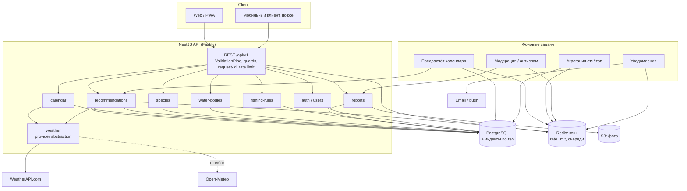

# 07. Целевая архитектура (to-be) и нефункциональные требования

Документ описывает, **какой системе нужно стать**, чтобы закрыть сценарии из
[01](01-product-overview.md) и модель из [06](06-recommendations.md). Текущее состояние —
[02](02-architecture.md). Порядок перехода — [08](08-roadmap.md).

## 1. Общая схема



Принципы:

1. **Модульный монолит**, а не микросервисы. Домен маленький, команда небольшая;
   границы модулей важнее физического разделения.
2. **Домен не знает про инфраструктуру.** Скоринг и правила — чистые функции; БД,
   HTTP и кэш — адаптеры. Это то, чего сейчас не хватает больше всего.
3. **Внешний провайдер — за интерфейсом.** `WeatherProvider` с реализациями WeatherAPI и
   Open-Meteo; смена/фолбэк не затрагивает домен.
4. **Всё, что можно посчитать заранее, считается заранее.** Календарь на 7–14 дней —
   ночной job, а не расчёт в запросе.

## 2. Технологические решения (ADR-сводка)

Статус: `принято` — можно начинать, `обсуждается` — нужно подтверждение владельца.

| # | Вопрос | Решение | Альтернативы | Обоснование | Статус |
|---|---|---|---|---|---|
| A1 | БД | PostgreSQL 16 | SQLite, MongoDB | Реляционные связи (виды/правила/отчёты), JSONB для гибких профилей, гео-индексы | предложено |
| A2 | Гео | `lat/lon` + B-tree/составные индексы, Haversine-запросы; PostGIS — при росте | PostGIS сразу, MongoDB geo | На MVP точек десятки тысяч — PostGIS избыточен, но двери открыты | предложено |
| A3 | ORM | Prisma | TypeORM, Drizzle, Kysely | Типобезопасность, миграции, читаемые запросы; сырой SQL для гео и бэктестов | предложено |
| A4 | Кэш | In-memory LRU (TTL) на MVP → Redis при >1 инстанса | Redis сразу, без кэша | Кэш погоды радикально снижает квоту; Redis нужен для распределённого rate limit | предложено |
| A5 | Очереди/фоновые задачи | `@nestjs/schedule` + BullMQ (Redis) | cron без очередей, Temporal | Предрасчёт и уведомления требуют ретраев и расписания | предложено |
| A6 | Аутентификация | JWT (access 15 мин + refresh), Argon2id | Сессии, OAuth-провайдеры | Просто и достаточно; позже — вход через соцсети | предложено |
| A7 | Фото | S3-совместимое хранилище, presigned URL | Локальный диск | Нельзя хранить пользовательские файлы в контейнере | предложено |
| A8 | Погодный провайдер | WeatherAPI + Open-Meteo как второй источник/фолбэк | только WeatherAPI | Бесплатный тариф даёт 3 дня, а календарь хочет 7–14 | **обсуждается** (зависит от бюджета) |
| A9 | API | REST, `/api/v1`, OpenAPI-first | GraphQL, tRPC | Клиенты простые, кэширование HTTP естественное | предложено |
| A10 | Фронтенд | Отдельное приложение (Next.js) | SSR внутри Nest | Разделение деплоя и кэша, современный DX | предложено |
| A11 | Деплой | Docker + managed Postgres + объектное хранилище | Serverless (Lambda) | Предсказуемая стоимость, фоновые задачи, БД-соединения | предложено |
| A12 | Наблюдаемость | pino-логи + request-id, Prometheus-метрики, Sentry | только stdout | Нужна диагностика ошибок провайдера и деградаций | предложено |

## 3. Модульная карта

| Модуль | Ответственность | Зависит от |
|---|---|---|
| `auth` | регистрация/вход, токены, роли | users |
| `users` | профиль, регион, избранное | — |
| `water-bodies` | водоёмы, точки, поиск, гео | regions |
| `regions` | регионы, таймзоны | — |
| `species` | справочник видов и **версии профилей** | — |
| `weather` | провайдеры, нормализация, кэш, история | Redis |
| `reports` | CRUD отчётов, фото, модерация, агрегаты | water-bodies, species, weather |
| `recommendations` | скоринг, правила, объяснения, календарь | species, weather, reports, rules |
| `rules` | региональные запреты и нормы | regions |
| `notifications` | подписки, email/push | users, recommendations |
| `health` | liveness/readiness, статус зависимостей | — |

Правило зависимостей: `recommendations` и `reports` **не** вызывают HTTP-провайдеров
напрямую — только через `weather`. `weather` не знает о рыбах и рекомендациях.

## 4. Схема данных (эскиз DDL)

```sql
CREATE TABLE region (
  id            uuid PRIMARY KEY DEFAULT gen_random_uuid(),
  name          text NOT NULL,
  country       text NOT NULL DEFAULT 'RU',
  timezone      text NOT NULL,
  rules_source  text,
  UNIQUE (name, country)
);

CREATE TABLE water_body (
  id          uuid PRIMARY KEY DEFAULT gen_random_uuid(),
  region_id   uuid NOT NULL REFERENCES region(id),
  name        text NOT NULL,
  type        text NOT NULL CHECK (type IN ('river','lake','reservoir','pond','commercial','sea')),
  lat         double precision NOT NULL,
  lon         double precision NOT NULL,
  bbox_lat_min double precision, bbox_lat_max double precision,
  bbox_lon_min double precision, bbox_lon_max double precision,
  flow        text, clarity text, bottom text,
  avg_depth_m numeric(5,1), max_depth_m numeric(5,1),
  is_paid     boolean NOT NULL DEFAULT false,
  created_at  timestamptz NOT NULL DEFAULT now()
);
CREATE INDEX water_body_region_idx ON water_body (region_id);
CREATE INDEX water_body_bbox_idx ON water_body (bbox_lat_min, bbox_lat_max, bbox_lon_min, bbox_lon_max);

CREATE TABLE spot (
  id           uuid PRIMARY KEY DEFAULT gen_random_uuid(),
  water_body_id uuid NOT NULL REFERENCES water_body(id) ON DELETE CASCADE,
  name         text,
  lat          double precision NOT NULL,
  lon          double precision NOT NULL,
  depth_m      numeric(5,1),
  bottom       text,
  created_by   uuid REFERENCES app_user(id),
  is_public    boolean NOT NULL DEFAULT false,
  status       text NOT NULL DEFAULT 'active'
);
CREATE INDEX spot_body_idx ON spot (water_body_id);
CREATE INDEX spot_geohash_idx ON spot (round(lat::numeric, 2), round(lon::numeric, 2));

CREATE TABLE fish_species (
  id         uuid PRIMARY KEY DEFAULT gen_random_uuid(),
  slug       text NOT NULL UNIQUE,
  name       text NOT NULL,
  latin      text,
  is_predator boolean NOT NULL DEFAULT false
);

CREATE TABLE species_profile (
  id              uuid PRIMARY KEY DEFAULT gen_random_uuid(),
  species_id      uuid NOT NULL REFERENCES fish_species(id),
  region_id       uuid REFERENCES region(id),      -- NULL = общий профиль
  version         integer NOT NULL,
  temp_optimal_c  numrange NOT NULL,
  temp_range_c    numrange NOT NULL,
  spawning_months smallint[] NOT NULL DEFAULT '{}',
  activity_month  jsonb NOT NULL,                  -- {"1":0.55,...}
  activity_hour   jsonb NOT NULL,                  -- {"7":0.95,...}
  pressure_sensitivity text,
  pressure_preference  text,
  wind_preference jsonb,
  light_preference text,
  depth_preference_m numrange,
  notes           text,
  sources         text[] NOT NULL DEFAULT '{}',
  is_active       boolean NOT NULL DEFAULT true,
  updated_by      text,
  updated_at      timestamptz NOT NULL DEFAULT now(),
  UNIQUE (species_id, region_id, version)
);

CREATE TABLE weather_forecast_day (
  id           uuid PRIMARY KEY DEFAULT gen_random_uuid(),
  spot_id      uuid NOT NULL REFERENCES spot(id) ON DELETE CASCADE,
  date         date NOT NULL,
  t_min_c      numeric(4,1), t_max_c numeric(4,1),
  pressure_avg_mb numeric(6,1), pressure_trend text,
  wind_avg_kph numeric(5,1), wind_dir text,
  cloud_pct    smallint, precip_mm numeric(5,1),
  moon_phase   text, moon_illumination smallint,
  sunrise      timestamptz, sunset timestamptz,
  hourly       jsonb NOT NULL,
  provider     text NOT NULL,
  fetched_at   timestamptz NOT NULL DEFAULT now(),
  UNIQUE (spot_id, date, provider)
);

CREATE TABLE catch_report (
  id            uuid PRIMARY KEY DEFAULT gen_random_uuid(),
  user_id       uuid NOT NULL REFERENCES app_user(id),
  spot_id       uuid REFERENCES spot(id),
  water_body_id uuid NOT NULL REFERENCES water_body(id),
  species_id    uuid NOT NULL REFERENCES fish_species(id),
  fished_at     timestamptz NOT NULL,
  time_from     time, time_to time,
  result        text NOT NULL CHECK (result IN ('caught','bites_only','skunked')),
  count         integer CHECK (count >= 0),
  weight_kg     numeric(6,3), length_cm numeric(5,1),
  released      boolean,
  bait_id       uuid REFERENCES bait(id),
  lure_id       uuid REFERENCES lure(id),
  groundbait_id uuid REFERENCES groundbait(id),
  rig_notes     text,
  notes         text,
  photo_keys    text[] NOT NULL DEFAULT '{}',
  weather_snapshot_id uuid REFERENCES weather_snapshot(id),
  geo_accuracy_m integer,
  moderation_status text NOT NULL DEFAULT 'pending',
  trust_score   numeric(3,2) NOT NULL DEFAULT 0.5,
  created_at    timestamptz NOT NULL DEFAULT now()
);
CREATE INDEX catch_report_spot_time_idx ON catch_report (spot_id, fished_at DESC);
CREATE INDEX catch_report_agg_idx ON catch_report (water_body_id, species_id, fished_at DESC)
  WHERE moderation_status = 'approved';

CREATE TABLE recommendation (
  id           uuid PRIMARY KEY DEFAULT gen_random_uuid(),
  spot_id      uuid NOT NULL REFERENCES spot(id) ON DELETE CASCADE,
  species_id   uuid REFERENCES fish_species(id),
  date         date NOT NULL,
  score        smallint NOT NULL CHECK (score BETWEEN 0 AND 100),
  breakdown    jsonb NOT NULL,
  windows      jsonb NOT NULL,
  tackle       jsonb, baits jsonb, groundbait jsonb, tactics text,
  warnings     text[] NOT NULL DEFAULT '{}',
  confidence   text NOT NULL,
  model_version text NOT NULL,
  inputs_hash  text NOT NULL,
  generated_at timestamptz NOT NULL DEFAULT now(),
  UNIQUE (spot_id, species_id, date, model_version)
);

CREATE TABLE fishing_rule (
  id            uuid PRIMARY KEY DEFAULT gen_random_uuid(),
  region_id     uuid NOT NULL REFERENCES region(id),
  water_body_id uuid REFERENCES water_body(id),
  species_id    uuid REFERENCES fish_species(id),
  type          text NOT NULL,
  date_from     date NOT NULL,
  date_to       date NOT NULL,
  text          text NOT NULL,
  source_url    text NOT NULL,
  verified_at   date NOT NULL
);
```

Замечания:

- `species_profile` и `recommendation` держат JSONB: профили редактируются контентом,
  breakdown/windows имеют переменную структуру. Для запросов по числовым полям выносятся
  отдельные колонки.
- Уникальность `recommendation` по `(spot, species, date, model_version)` даёт
  идемпотентность предрасчёта.
- Отчёты фильтруются по `moderation_status` в агрегатах, а не удаляются.

## 5. Кэширование и работа с провайдером

| Ключ | TTL | Инвалидация | Зачем |
|---|---|---|---|
| `wx:current:{lat2},{lon2}` | 10 мин | по времени | текущая погода, десятки запросов на точку |
| `wx:forecast:{lat2},{lon2}:{days}` | 30–60 мин | по времени | прогноз, ограничение квоты |
| `wx:geo:{q}` | 24 ч | по времени | геокодирование города |
| `cal:{spotId}:{from}:{to}` | 1 ч | при обновлении прогноза/правил/отчётов | готовый календарь |
| `rep:agg:{waterBodyId}:{speciesId}:{days}` | 5–15 мин | при новом отчёте | «что ловят рядом» |
| `rules:{regionId}:{year}` | 24 ч | при правке правил | запреты |

Стратегия: **stale-while-revalidate** — отдаём кэш, обновляем в фоне. Ошибки провайдера
не «ломают» ответ: при наличии устаревшего кэша возвращаем его с флагом `stale: true`.

Rate limit и квоты:

- исходящие запросы — token bucket на провайдера, лимит из конфига;
- входящие — 60 req/мин на IP, 300 req/мин на пользователя;
- при 429 от провайдера — exponential backoff с джиттером, деградация на второй провайдер.

## 6. Нефункциональные требования

| Категория | Требование | Проверка |
|---|---|---|
| Латентность | p95 календаря ≤ 300 мс из кэша, ≤ 1.5 с при холодном расчёте | нагрузочный тест k6 |
| Доступность | 99.5 % в сезон (апрель–октябрь), плановые работы вне выходных | мониторинг |
| Пропускная способность | 30 rps в пике, 200 k MAU на горизонте года | k6 + профиль БД |
| Консистентность | отчёты — read-your-writes; агрегаты допускают отставание ≤ 5 мин | тесты |
| Отказоустойчивость | деградация без погоды: календарь строится по климату, `confidence = low` | chaos-тест провайдера |
| Безопасность | OWASP Top 10, секреты только в env/secret manager, TLS, rate limit, аудит модерации | чек-лист + ревью |
| Приватность | точные координаты чужих точек не публикуются без согласия; экспорт/удаление данных | тесты API |
| Наблюдаемость | request-id во всех логах, метрики ошибок провайдера, latency, кэш-хиты | дашборд |
| Резервное копирование | PITR Postgres, RPO ≤ 15 мин, RTO ≤ 2 ч; фото — версионирование в S3 | учения |
| Стоимость | укладываться в бюджет провайдера: кэш-хит ≥ 90 %, алерты на 80 % квоты | отчёт по метрикам |
| Локализация | RU на старте; единицы СИ; время локальное для точки | тесты |
| Доступность UI | WCAG 2.1 AA для веба, работа при 3G, PWA-офлайн-кэш календаря | аудит |

## 7. Безопасность и приватность

1. **Секреты** — только переменные окружения/secret manager. Ключ WeatherAPI не попадает
   в клиент, в логи (URL маскируется), в репозиторий. Ротация ключа — без релиза.
2. **Валидация** — глобальный `ValidationPipe({ transform: true, whitelist: true })`,
   ограничения размеров, запрет лишних полей. Никаких «сырых» проксирований ввода.
3. **Авторизация** — guard по ролям; пользователь редактирует только свои отчёты;
   модератор — только модерацию; админ — правила/справочники.
4. **UGC** — загрузка фото через presigned URL с проверкой MIME/размера, антивирус/скан,
   модерация первых отчётов, лимит отчётов в сутки, rate limit, капча на регистрации.
5. **Гео-приватность** — округление координат в публичных ответах до ~300–500 м,
   отдельный флаг «показывать точку».
6. **Логи** — без токенов, паролей, email в открытом виде; PII минимизируется.
7. **Дисклеймер** — «сервис носит информационный характер, соблюдайте правила рыболовства
   региона» на всех экранах с рекомендациями.

## 8. Риски архитектуры

| Риск | Вероятность | Влияние | Митигация |
|---|---|---|---|
| Квота/цена погодного провайдера | высокая | высокое | кэш, второй провайдер, предрасчёт, алерты на 80 % |
| Прогноз на 7–14 дней недоступен на бесплатном тарифе | высокая (уже факт) | высокое | Open-Meteo/платный тариф; ограничить горизонт 3 днями с честной пометкой |
| Нет температуры воды | высокая | среднее | модель-прокси + сбор данных от пользователей |
| Мало отчётов → слабые локальные рекомендации | высокая | среднее | показывать `confidence`, сеять отчёты вручную, партнёрства с базами |
| Спам и «слив» точек | средняя | высокое | модерация, репутация, округление координат |
| Ошибки в справочнике правил → юридические претензии | средняя | высокое | источник + дата сверки, дисклеймер, приоритет официального текста |
| Рост стоимости БД/фото | средняя | среднее | ретеншен фото, сжатие, лимиты |
| Долг текущего кода (нет валидации/тестов) | высокая | среднее | этап 0 в [08](08-roadmap.md) |

## 9. Как перейти от текущего кода

1. **Не переписывать всё сразу.** Текущий `weather`-модуль остаётся, но получает:
   провайдер-интерфейс, нормализованную модель, кэш и корректную фазу Луны на день.
2. Ввести слой БД (Prisma), первую миграцию с `region`, `water_body`, `spot`,
   `fish_species`, `species_profile`, `fishing_rule`.
3. Вынести скоринг в `recommendations/scoring` как чистые функции + golden-тесты.
4. Добавить `calendar`-эндпоинт и ночной предрасчёт; только после этого — фронтенд.
5. Отчёты и аутентификация — следующим этапом, чтобы не блокировать запуск календаря.

Детальные шаги, оценки и критерии готовности — в [08-roadmap.md](08-roadmap.md).
